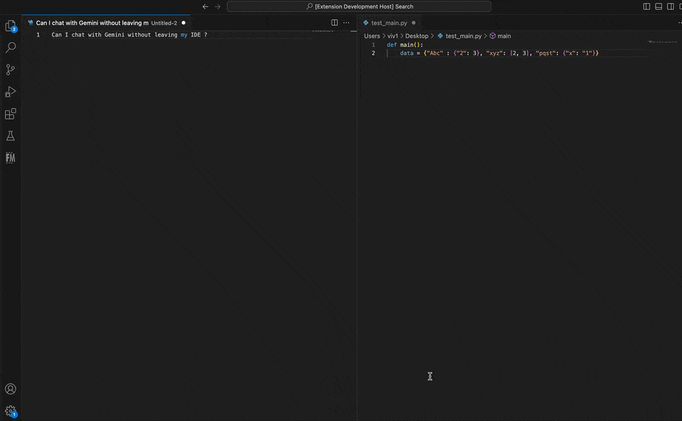

</a>

# Web Chat for Gemini

VSCode extension to interact with Gemini without leaving the IDE.

## Introduction

> NOTE: This extension is updated to use the Gemini 1.5 Flash APIs instead of the Gemini Pro Vision. Gemini 1.5 Flash is Google's next-generation model that is faster and more cost-efficient with advanced vision understanding. Also, the Pro vision API is getting deprecated on July 12, 2024.

Have a quick question on your code or confused about the syntax ? Maybe you want to explore different ways to do a task. Or maybe you want a feedback on an image you are using, all **without spending a dime** ?

Using "**Web Chat for Gemini**", you can do all this, and more without leaving your VS code IDE. This extension gives you the ability to interact with the Gemini Pro APIs through your IDE. 

Google Generative AI Gemini pro APIs have **generous [free tier limits](https://ai.google.dev/pricing)**. You can even take advantage of the gemini multimodal LLM by uploading images along with your texts.

Ask the extension anything from generating code to getting feedback on your code to suggesting steps to earn money, and it will do it all for you.

Get your API key [here](https://aistudio.google.com/app/), and start harnessing the power.

## Features
- ✨ Powered by Gemini pro and Gemini 1.5 Flash APIs
- ✨ Provides relevant code and text outputs based on user inputs
- ✨ Remembers chat context and history, can carry long conversations
- ✨ Supports multi modal input (text and images)
- ✨ Supports multiple images as input
- ✨ Supports dark and light mode toggle
- ✨ Supports copy button to directly copy code snippets from response

## Trip Budget Companion

This repository also includes a responsive travel-budget PWA for the Algeria–Malaysia trip. Open **Trip Budget Companion** from the VS Code command palette to use it in a webview, or serve the `trip-budget/` directory from an HTTPS static host to install it on iPhone, Mac, or another browser.

The companion includes an expense ledger with EUR, MYR, DZD, and SGD, editable exchange-rate estimates and budget categories, a starter itinerary with per-stage estimates itemized into accommodation, local transport, meals, activities, and other costs, a customizable packing checklist, and user-created reminders. Tap or click any itinerary stage to edit its dates, location, status, details, and all cost lines, including accommodation; the dedicated budget button opens the same editor. Stage research links open external searches for lodging, transport, activities, restaurant locations in Maps, destination maps, photos, and menus, with destination and dates included where appropriate. Search results are not verified or imported automatically, so check the details and enter confirmed costs yourself. The app comes prefilled with the trip dates, €2,000 on-site budget, the booked Dorms KL stay (14–17 Nov 2026), a flexible Malaysia period (17 Nov–31 Jan), the planned Singapore day trip, and proposed stops. It suggests dates for the route from 17 Nov through 31 Jan to provide a complete first-draft calendar; these are planning placeholders, not user-confirmed reservations. Other links open searches for flights, official entry requirements, and seasonal weather. Download an `.ics` calendar from **Étapes → Ajouter au calendrier** and open it with Apple Calendar or another calendar app. It includes all-day stage blocks and a weekly Sunday 18:00 budget/next-step review; no travel times are invented. The Singapore day trip is provisionally placed on 1 Jan. Prices, flight times, and reservations other than Dorms KL are not supplied or claimed as verified; add prices to each stage as they are confirmed. Proposed stops include Melaka, Penang, Langkawi, Kota Bharu/Kuala Terengganu, Kuching/Kota Kinabalu, Johor Bahru/Singapore, and a return to Kuala Lumpur. The baggage checklist is a suggested preparation list and starts unchecked because no items were confirmed packed. Data stays in that browser or webview's local storage and is not synchronized automatically; use **Settings → Export JSON** and import the file on another device for manual transfer. The €2,000 budget excludes international airfare.

Each stage editor also lets you record the name and link of an accommodation found during your research, so you can keep the listing with its price and other stage costs. To avoid a crowded itinerary, each stop now has just **Carte & lieux** and **Modifier** actions. The explorer opens an interactive Google Map plus curated nearby sights, food places, and lodging searches; each place has direct Maps/address, photos, and (for food) menu/price links. Tap a pin in the map or open a place in Maps to see available details, reviews, photos, and directions. The daily book uses the same explorer for its **Carte & restaurants** action. Suggestions and prices are not verified or live; only Dorms KL is marked as booked, and its price was not provided. Map tiles and external searches require an Internet connection.

The itinerary tab's **Mon itinéraire sur Maps** opens a regional map and ordered stage list with a Google Maps directions link for each land/transit leg. It also includes the proposed Johor Bahru–Singapore day trip and a return to Johor Bahru. The Bornéo connections are explicitly shown as flight searches rather than fictional road directions. Kota Bharu/Kuala Terengganu and Kuching/Kota Kinabalu remain unresolved; the displayed map searches use provisional city examples until you edit/confirm the stages.

The itinerary also includes a comparison of Kota Bharu, Kuala Terengganu, Kuantan, Kota Kinabalu, and Ipoh with estimated low-cost dorm/private-room ranges in EUR per night, map searches, dated Booking.com availability searches, and a shortcut to edit each linked stage. Price bands are rough conversions of planning estimates (about €1 ≈ RM 4.7), not live quotes or confirmed lodging; always verify the total price, room type, taxes, and availability with the booking site. Kota Bharu/Kuala Terengganu/Kuantan are alternatives for the same proposed east-coast dates; Kota Kinabalu is a Bornéo alternative requiring flights; Ipoh is an option for the flexible January week.

The baggage checklist is tailored to the long, hot, humid Malaysia stay, weekly laundry, city/hostel travel, rain, and the proposed Singapore day trip. It includes suggested clothing quantities, separate cabin-bag items, a short "before departure" action list, documents, electronics, toiletries, and hostel essentials. On first load after this checklist update, new items are added to the existing local list without clearing checked items or custom entries. Quantities are starting suggestions; check entry, medical, customs, airline, and baggage requirements with official sources and relevant professionals.

The **Mon livre** tab turns the on-site dates into 80 page-by-page diary entries, with destination photos, map/restaurant/photo/menu links, editable daily costs by category, location, and notes. Daily plans are saved locally and included in JSON backups. Destination photos are illustrative Wikimedia Commons images with source and license credits; they and web searches require an Internet connection. The €25/day figure is only the editable trip-budget pace (€2,000 ÷ 80), not a researched price or reservation.

The home dashboard hides the extra introductory banner and uses a high-contrast, larger-type budget panel, the first two itinerary items, and four direct actions for expenses, packing, reminders, and the daily book. Detailed stage prices, cost categories, and research links remain in their dedicated tabs.

For iPhone, open the HTTPS site in Safari and choose **Share → Add to Home Screen**. On Mac, use the browser's install option if available. Offline app-shell support is enabled by the service worker on HTTPS. Browser notifications require permission and an open app; reminders are not delivered reliably while the app is closed or suspended, and there is no remote notification service.

## Installation
There are 2 ways to install:
1. Search for "Web Chat for Gemini" in the [VS Code Marketplace](https://marketplace.visualstudio.com/vscode), and install the extension. [Direct link to the extension](https://marketplace.visualstudio.com/items?itemName=wewake.webchatforgemini).
2. From within the VS code IDE, you can use the shortcut (*Ctrl+Shift+X for Linux/Windows, Cmd+Shift+X for Mac*) to open the Extension view and search for "Web Chat for Gemini" and install the extension.

## Usage
- After installation, open the command palette (*Ctrl+Shift+P for Linux/Windows, Cmd+Shift+P for Mac*) and type/select "Web Chat for Gemini", and click Enter. 

- This will open the "Web Chat for Gemini" in a new tab. On the top right side section, click the settings (⚙️) icon to where you can save your Gemini API key (Get your API key [here](https://aistudio.google.com/app/)).

- Use the input text area at the bottom to start the conversation. You can also use the file upload pin on the left of the input text area to upload any image. Click on "Send" to send the request.

(Suggestion: Assign a VS code shortcut key to open "Web Chat for Gemini" quickly.)

## Data Security
Your Gemini API Key stays stored locally (in VScode webview local storage, and in-memory). It is not stored anywhere else remotely. Also, all the chat conversations and communication is directly with the Gemini APIs. It is not tracked, or monitored by anything in between. Please feel free to check out the source code to validate this, if needed.

## License
This project is licensed under the MIT License.

## Contributing
Ways to help:

- File any new feature requests: Suggest features that'll help you utilize the extension more effectively.

- File any issues or bugs or feedback: Point out any issue with the functioning of the extension, or any discrepancy you have observed, or any general feedback you might have.

- Pick up open issues: Pick up and fix existing issues  by submitting a pull request on the Github repository.

## Support
For any inquiries or assistance, please contact hello@wewake.dev

## Tutorials
You can refer to this informative and useful tutorial on **Web Chat for Gemini** : [WebChatForGemini : The VSCode Companion](https://coderlegion.com/264/webchatforgemini-the-vscode-companion).
